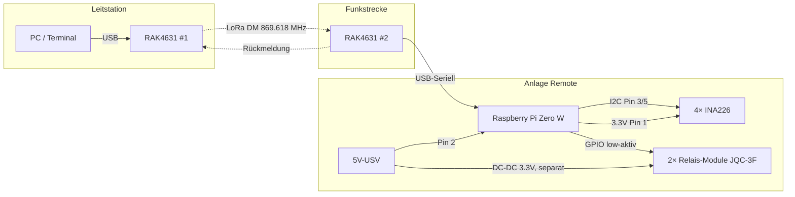

# 🎛️ Anlage-mit-MeshCore-steuern

**Fernwirkung über LoRa-Mesh:** Steuerung einer entfernten Anlage per Klartext-Payload über MeshCore Direct Messages (DM) – mit Rückmeldung von Messwerten und Betriebszuständen.

> Grundlage dieses Repos ist die **Projektstudie vom 20.08.2026** (Grundarchitektur und Dimensionierung abgeschlossen). Dieses Repo begleitet die Umsetzung der Studie in ein funktionierendes System. **Aktueller Stand: 2 Ausgangskanäle** (Architektur-Entscheid 28.10.2026).

---

## 🧩 Hardware-Konfiguration

| Komponente | Typ | Funktion |
|---|---|---|
| Funkstrecke | 2× RAK4631 | MeshCore Direct Message |
| Steuereinheit | Raspberry Pi Zero W | Parser, I2C-Master, GPIO |
| Aktoren | 2× 1-Kanal-Relais-Module (JQC-3F-03VDC-C) | Schalten, NO-Verdrahtung (stromlos = offen) |
| Treiber | S8550 onboard der Module | GPIO → Relais, Low-aktiv |
| Sensoren | 4× INA226 (2 Lastkanäle + 2 Versorgungsschienen) | Spannung + Strom via I²C |
| Versorgung | 5-V-USV (ausfallfrei); DC-DC 3.3 V separat für die Relais-Module | GND gemeinsam |

> ℹ️ **Relais-Update (28.10.2026):** Statt der Reed-Relais aus der Studie kommen vorhandene Relais-Module (JQC-3F-03VDC-C, 3-V-Spule) zum Einsatz. Sie werden vom Pi **direkt** angesteuert (VCC = 3.3 V über **separaten** DC-DC, IN = LOW → EIN) – Details in **[docs/RELAIS-MODUL.md](docs/RELAIS-MODUL.md)**, Versorgungspfade im **[Blockschaltbild](docs/BLOCKSCHALTBILD.md)**.

---

## 🔄 Systemarchitektur



---

## 📡 Funk-Parameter (CH-Installation)

| Parameter | Wert |
|---|---|
| Frequenz | 869.618 MHz (P-Band) |
| Duty Cycle | **10 %** (360 s/h Sendezeit, ETSI EN 300 220) |
| Max. ERP | 500 mW (27 dBm) |
| MeshCore-Profil | SF8 / BW62.5 / CR4/8 (firmware-abhängig) |

**Kapazität:** Ein Befehls-/Antwort-Zyklus (2 Kanäle) dauert ~570 ms → rechnerisch **~630 Zyklen/Stunde** möglich. Das P-Band erlaubt 10× mehr Duty Cycle als das oft zitierte 1 %.

**Reichweite (DM, ohne Hops):** 5–15 km (Freifeld) / 2–8 km (ländlich) / 0.5–2 km (bebaut). Kritische Schwelle RSSI < -120 dBm, min. 10 dB Fade Margin einplanen.

---

## 📦 Payload-Design

Klartext mit SEQ/CMD/ACK, max. ~120–133 Zeichen pro DM (nach Crypto-Overhead). Das vollständige Regelwerk – Telegrammtypen, Befehlsreferenz, Timeout/Retry, Dedup, Watchdog, NAK-Codes, Airtime-Budget – steht in der **[Protokoll-Spezifikation v0.2](docs/PROTOKOLL.md)**.

```
# Befehl (Leitstation → Anlage)
SEQ:nn;CMD:REL1=ON,REL2=OFF

# Antwort (Anlage → Leitstation, 55 Zeichen)
SEQ:nn;ACK;U1=12.3;I1=0.56;U2=24.0;I2=1.23;R1=ON;R2=OFF

# Heartbeat (optional, default aus)
HB;U1=12.3;I1=0.56;R1=ON;R2=OFF
```

**Robustheitskonzept:** SEQ + ACK + Timeout + Retry + Deduplizierung + Watchdog (sicheres Verhalten bei Kommunikationsverlust).

**Fail-Safe (Hardware):** Stromausfall → beide Relais **öffnen** den geschlossenen Stromkreis (NO-Verdrahtung, stromlose Spule = offen); Pull-ups an der Modul-3.3-V-Schiene halten die Relais auch bei bootendem/hängendem Pi AUS – Details im [Blockschaltbild](docs/BLOCKSCHALTBILD.md), Abs. 4.

**Dimensionierung:** 2 Relais + 4 Messwerte passen locker in einen Payload (~45 % Auslastung); Polling alle 2–3 Minuten nutzt nur ~3–5 % des Duty-Cycle. Die beiden Versorgungs-INA226 (5 V/3.3 V) werden lokal geloggt (Protokoll-Backlog `US=`/`UR=`).

---

## 🔋 Power Budget Remote-Station

| Komponente | Strom | Leistung |
|---|---|---|
| Pi Zero W (headless, WiFi aus) | 100–110 mA @ 5 V | 500–550 mW |
| RAK4631 (Idle) | ~6 mA @ 3.3 V | ~20 mW |
| 4× INA226 | 1.4 mA @ 3.3 V | 4.6 mW |
| 2 Relais EIN (JQC-3F @ 3.3 V, eigener DC-DC) | ~264 mA @ 3.3 V | ~873 mW |
| **TOTAL (2 Relais EIN)** | | **~1.5 W** |

> ⚠️ Mit den Relais-Modulen gilt gegenüber der Studie ein neues Budget: beide Relais gleichzeitig EIN → **~1.5 W (≈36 Wh/Tag)** statt ~0.64 W mit Reed-Relais. Die Spulen hängen am **eigenen 3.3-V-DC-DC**, nicht an den Pi-Rails. Bei Netzbetrieb (USV) unkritisch; bei Solarbetrieb wäre die Reed-Relais-Variante vorzuziehen ([RELAIS-MODUL.md](docs/RELAIS-MODUL.md), Abs. 5/6).

---

## 🗺️ Roadmap

- [x] **Protokoll-Spezifikation** – [docs/PROTOKOLL.md](docs/PROTOKOLL.md) (v0.2, 2 Kanäle, 28.10.2026)
- [x] **Relais-Beschreibung** (JQC-3F-03VDC-C) – [docs/RELAIS-MODUL.md](docs/RELAIS-MODUL.md) (28.10.2026)
- [x] **Blockschaltbild** (2 Kanäle, USV/DC-DC, Fail-Safe) – [docs/BLOCKSCHALTBILD.md](docs/BLOCKSCHALTBILD.md) (28.10.2026)
- [ ] **Schaltplan (detailliert)** Pinbelegung, INA226-Shunts, I²C-Adressen, Absicherung
- [ ] **Python-Code** Serial-Parser auf Pi Zero W
- [ ] **MeshCore-Konfiguration** RAK4631 für DM-Betrieb
- [ ] **Loopback-Test** mit beiden Radios nebeneinander

---

## ❓ Offene Fragen

- Welche konkrete MeshCore-Firmware-Version auf den RAK4631?
- Companion-App oder eigenes Python-Script auf der Leitstation?
- Serielles Protokoll RAK4631 ↔ Pi: AT-Befehle oder MeshCore Companion Protocol?
- Antennenaufstellung – Sichtverbindung möglich?
- ~~Braucht es Verschlüsselung über den MeshCore-Standard hinaus?~~ → Für v0.2 beantwortet: MeshCore-DM ist Ende-zu-Ende-verschlüsselt, keine zusätzliche Schicht nötig (Protokoll-Spezifikation, Abs. 13).
- ~~Stromversorgung: Netz vorhanden oder Solar/Akku nötig?~~ → Beantwortet: **ausfallfreie 5-V-Versorgung (USV)**, 3.3 V via separatem DC-DC (Blockschaltbild, Abs. 1/3).
- Protokoll v0.3: Versorgungswerte `US=`/`UR=` in den ACK aufnehmen?

---

## 🔗 Verweise

- [MeshCore (Original)](https://meshcore.io) – offizielle Website
- [meshcore-dev auf GitHub](https://github.com/meshcore-dev) – offizieller MeshCore-Code
- [meshcore.ch](https://www.meshcore.ch) – Schweizer MeshCore-Community (Radio-Einstellungen)
- Verwandte Projekte: [meshcore-responder-station](https://github.com/Paul-3400/meshcore-responder-station), [meshcore-duty-cycle-observer](https://github.com/Paul-3400/meshcore-duty-cycle-observer)

---

Autor: Paul Simmen mit Vibe (GLM-5-latest-short), 28.10.2026
