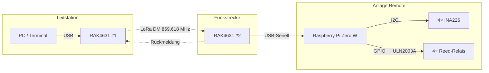

# 🎛️ Anlage-mit-MeshCore-steuern

**Fernwirkung über LoRa-Mesh:** Steuerung einer entfernten Anlage per Klartext-Payload über MeshCore Direct Messages (DM) – mit Rückmeldung von Messwerten und Betriebszuständen.

> Grundlage dieses Repos ist die **Projektstudie vom 20.08.2026** (Grundarchitektur und Dimensionierung abgeschlossen). Dieses Repo begleitet die Umsetzung der Studie in ein funktionierendes System.

---

## 🧩 Hardware-Konfiguration

| Komponente | Typ | Funktion |
|---|---|---|
| Funkstrecke | 2× RAK4631 | MeshCore Direct Message |
| Steuereinheit | Raspberry Pi Zero W | Parser, I2C-Master, GPIO |
| Sensoren | 4× INA226 (I2C) | Spannung + Strom messen |
| Aktoren | 4× Reed-Relais (Standex SIL 05-1A72-71D) | Schalten |
| Treiber | ULN2003A | GPIO → Relais, integrierte Freilaufdioden |

---

## 🔄 Systemarchitektur



---

## 📡 Funk-Parameter (CH-Installation)

| Parameter | Wert |
|---|---|
| Frequenz | 869.618 MHz (P-Band) |
| Duty Cycle | **10 %** (360 s/h Sendezeit, ETSI EN 300 220) |
| Max. ERP | 500 mW (27 dBm) |
| MeshCore-Profil | SF8 / BW62.5 / CR4/8 (firmware-abhängig) |

**Kapazität:** Ein Befehls-/Antwort-Zyklus dauert ~772 ms → rechnerisch **~466 Zyklen/Stunde** möglich. Das P-Band erlaubt 10× mehr Duty Cycle als das oft zitierte 1 %.

**Reichweite (DM, ohne Hops):** 5–15 km (Freifeld) / 2–8 km (ländlich) / 0.5–2 km (bebaut). Kritische Schwelle RSSI < -120 dBm, min. 10 dB Fade Margin einplanen.

---

## 📦 Payload-Design

Klartext mit SEQ/CMD/ACK, max. ~120–133 Zeichen pro DM (nach Crypto-Overhead). Das vollständige Regelwerk – Telegrammtypen, Befehlsreferenz, Timeout/Retry, Dedup, Watchdog, NAK-Codes, Airtime-Budget – ist in der **[Protokoll-Spezifikation](docs/PROTOKOLL.md)** festgelegt.

```
# Befehl (Leitstation → Anlage)
SEQ:nn;CMD:REL1=ON,REL2=OFF

# Antwort (Anlage → Leitstation)
SEQ:nn;ACK;U1=12.3;I1=0.56;U2=24.0;I2=1.23;U3=5.0;I3=0.09;U4=3.3;I4=0.04;R1=ON;R2=OFF;R3=OFF;R4=OFF

# Heartbeat (optional, default aus)
HB;U1=12.3;I1=0.56;R1=ON;R2=OFF;R3=OFF;R4=OFF
```

**Robustheitskonzept:** SEQ + ACK + Timeout + Retry + Deduplizierung + Watchdog (sicheres Verhalten bei Kommunikationsverlust).

**Dimensionierung:** 4 Relais + 4 INA226 (8 Messwerte) passen in einen Payload (~60–70 % Auslastung); Polling alle 2–3 Minuten ist komfortabel möglich.

---

## 🔋 Power Budget Remote-Station

| Komponente | Strom | Leistung |
|---|---|---|
| Pi Zero W (headless, WiFi aus) | 100–110 mA @ 5 V | 500–550 mW |
| RAK4631 (Idle) | ~6 mA @ 3.3 V | ~20 mW |
| 4× INA226 | 1.4 mA @ 3.3 V | 4.6 mW |
| 1 Reed-Relais (Durchschnitt) | 10 mA @ 5 V | 50 mW |
| ULN2003A Treiber | <1 mA | vernachlässigbar |
| **TOTAL** | **~127 mA @ 5 V** | **~637 mW** |

**→ 15.3 Wh/Tag = 0.46 kWh/Monat**

---

## 🗺️ Roadmap

- [x] **Protokoll-Spezifikation** – [docs/PROTOKOLL.md](docs/PROTOKOLL.md) (v0.1, 28.10.2026)
- [ ] **Schaltplan** Pi Zero W + I2C + ULN2003A + Relais
- [ ] **Python-Code** Serial-Parser auf Pi Zero W
- [ ] **MeshCore-Konfiguration** RAK4631 für DM-Betrieb
- [ ] **Loopback-Test** mit beiden Radios nebeneinander

---

## ❓ Offene Fragen

- Welche konkrete MeshCore-Firmware-Version auf den RAK4631?
- Companion-App oder eigenes Python-Script auf der Leitstation?
- Serielles Protokoll RAK4631 ↔ Pi: AT-Befehle oder MeshCore Companion Protocol?
- Antennenaufstellung – Sichtverbindung möglich?
- ~~Braucht es Verschlüsselung über den MeshCore-Standard hinaus?~~ → Für v0.1 beantwortet: MeshCore-DM ist Ende-zu-Ende-verschlüsselt, keine zusätzliche Schicht nötig (siehe Protokoll-Spezifikation, Abs. 13).
- Watchdog-Verhalten: Was tut die Anlage bei Kommunikationsverlust? → Vorgabe in der Protokoll-Spezifikation (Abs. 9): HOLD (Default) oder konfigurierbar SAFE.
- Stromversorgung: Netz vorhanden oder Solar/Akku nötig?

---

## 🔗 Verweise

- [MeshCore (Original)](https://meshcore.io) – offizielle Website
- [meshcore-dev auf GitHub](https://github.com/meshcore-dev) – offizieller MeshCore-Code
- [meshcore.ch](https://www.meshcore.ch) – Schweizer MeshCore-Community (Radio-Einstellungen)
- Verwandte Projekte: [meshcore-responder-station](https://github.com/Paul-3400/meshcore-responder-station), [meshcore-duty-cycle-observer](https://github.com/Paul-3400/meshcore-duty-cycle-observer)

---

Autor: Paul Simmen mit Vibe (GLM-5-latest-short), 28.10.2026
