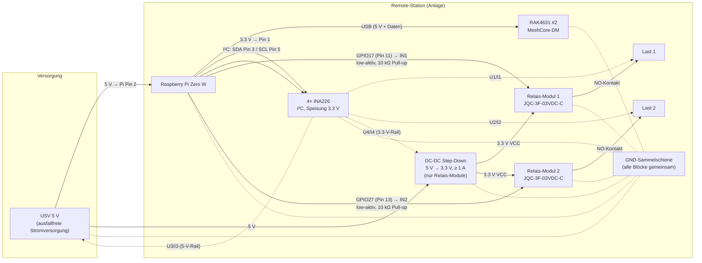

# 🧱 Blockschaltbild – Remote-Station (2 Kanäle)

- **Version:** 0.1
- **Status:** Blockschaltbild (funktional); detaillierter Schaltplan folgt
- **Basis:** Vorgaben Paul (28.10.2026), [PROTOKOLL.md](PROTOKOLL.md) v0.2, [RELAIS-MODUL.md](RELAIS-MODUL.md)

---

## 1. Vorgaben (Entscheide vom 28.10.2026)

| Nr. | Vorgabe | Umsetzung hier |
|---|---|---|
| 1 | 2 Ausgangskanäle | 2× einzelne 1-Kanal-Relais-Module (JQC-3F-03VDC-C) |
| 2 | Separate 3.3-V-Speisung der Relais-Module (NICHT via Pi) | eigener DC-DC-Wandler 5 V → 3.3 V (≥ 1 A) |
| 3 | GND immer an derselben Schiene | gemeinsame GND-Sammelschiene über alle Blöcke |
| 4 | 5 V für den Pi an **Pin 2** | USV → Pi Pin 2 (physikalische Nummerierung) |
| 5 | Sensoren ab **Pin 1** (3.3 V) | 4× INA226 an Pi 3.3-V-Rail (Pin 1) |
| 6 | Ausfallfreie Versorgung = **5 V** (USV); 3.3 V via DC-DC | siehe Diagramm |
| 7 | **Stromausfall → beide Module öffnen den Stromkreis** | Last an **NO-Kontakt** (Relais stromlos = offen) |

---

## 2. Blockschaltbild

---

## 3. Versorgungspfade

| Verbraucher | Quelle | Pfad |
|---|---|---|
| Pi Zero W | 5-V-USV | Pin 2 (5 V) |
| RAK4631 #2 | Pi (USB-Port) | USB (5 V + Daten) |
| 4× INA226 | Pi 3.3-V-Rail | Pin 1 (3.3 V) |
| Relais-Module 1 + 2 (Spulen + S8550) | **eigener** DC-DC 3.3 V | VCC der Module |

- Die Relais-Spulen (~264 mA bei 2× EIN) belasten die Pi-Rails **nicht**.
- Gemeinsamer GND ist Voraussetzung für die GPIO-Steuerung und die I²C-Messungen (INA226 #4 misst die externe 3.3-V-Schiene gegen gemeinsame Masse).

---

## 4. Fail-Safe-Verhalten (Kernvorgabe: stromlos = Stromkreis offen)

| Ereignis | Relais 1/2 | Mechanismus |
|---|---|---|
| **USV-Stromausfall** (5 V weg) | **offen** ✅ | Spulen stromlos → NO-Kontakt offen (Vorgabe 7) |
| 3.3-V-DC-DC fällt aus (Pi läuft) | **offen** | Spulen stromlos, unabhängig vom GPIO-Zustand |
| Pi spannungslos / im Boot, GPIO undefiniert | **offen** | 10 kΩ Pull-up von IN zur **Modul-3.3 V** hält IN HIGH (Low-aktiv!) |
| Pi hängt mit GPIO LOW (Relais wäre EIN) | offen nach Reboot | **bcm2835-Hardware-Watchdog** aktivieren → Reboot setzt GPIOs zurück → Pull-ups greifen |
| Funkverlust (Anlage läuft) | HOLD (Default) oder SAFE | Software-Watchdog gem. PROTOKOLL.md, Abs. 9 |

> ⚠️ Wichtig: Die Pull-ups müssen an der **Modul-3.3-V-Schiene** (nach dem DC-DC) angeschlossen werden, nicht an der Pi-3.3-V-Rail – damit ist das Relais auch bei fehlendem Pi garantiert AUS.

---

## 5. Messkanal-Zuordnung (INA226)

| INA226 | misst | I²C-Adresse (Vorschlag) | Protokollfeld (v0.2) |
|---|---|---|---|
| #1 | Last 1: Spannung + Strom | 0x40 | `U1` / `I1` |
| #2 | Last 2: Spannung + Strom | 0x41 | `U2` / `I2` |
| #3 | 5-V-USV-Schiene: Spannung + Gesamtstrom | 0x42 | lokal geloggt (v0.3-Kandidat `US=`) |
| #4 | 3.3-V-Relais-Schiene: Spannung + Strom | 0x43 | lokal geloggt (v0.3-Kandidat `UR=`) |

- Adressen hängen von den A0/A1-Brücken der INA226-Module ab → im Detail-Schaltplan konkretisieren.
- INA226 #3 (5-V-Messung) funktioniert problemlos: Bus-Spannungseingang bis 36 V, Speisung bleibt 3.3 V vom Pi.

---

## 6. GPIO-Belegung (Vorschlag)

| Kanal | GPIO | Phys. Pin | Bemerkung |
|---|---|---|---|
| Relais 1 (IN1) | GPIO17 | Pin 11 | low-aktiv, kein Standard-Boot-Feature |
| Relais 2 (IN2) | GPIO27 | Pin 13 | low-aktiv, kein Standard-Boot-Feature |
| I²C SDA / SCL | GPIO2 / GPIO3 | Pin 3 / Pin 5 | fix für INA226 |

> Hinweis: GPIO17/27 ziehen beim Boot intern nach LOW (Pull-Down) – ohne externen Pull-up würden die Relais beim Boot kurz EIN! Genau deshalb sind die 10-kΩ-Pull-ups Pflicht (siehe Abs. 4).

---

## 7. Offene Punkte

- [ ] USV-Typ konkretisieren (Pufferakku-Modul? Kapazität für gewünschte Brückenzeit?)
- [ ] Absicherung/Leitungsschutz der 5-V- und 3.3-V-Pfade (Schmelzsicherung/Polyfuse)
- [ ] Snubber je nach Lastart (induktiv?) – siehe RELAIS-MODUL.md, Abs. 7
- [ ] I²C-Adressen der INA226-Module verifizieren (A0/A1)
- [ ] Protokoll v0.3: Felder `US=`/`UR=` für die Versorgungswerte? (Backlog)

---

## 8. Verweise

- [PROTOKOLL.md](PROTOKOLL.md) – Protokoll v0.2 (2 Kanäle)
- [RELAIS-MODUL.md](RELAIS-MODUL.md) – Komponentenbeschreibung JQC-3F
- [README.md](../README.md) – Projektübersicht

---

Autor: Paul Simmen mit Vibe (GLM-5-latest-short), 28.10.2026
