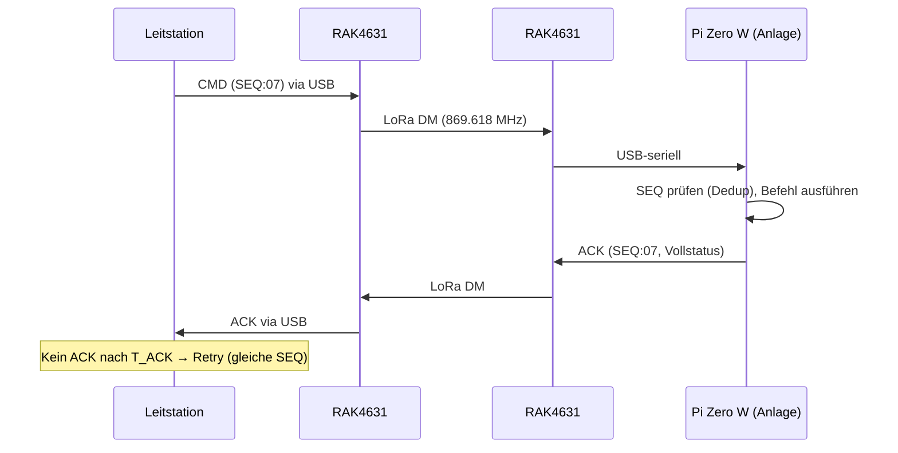

# 📡 Protokoll-Spezifikation – Anlagensteuerung via MeshCore-Payload

**Version:** 0.1 (Entwurf)
**Status:** in Arbeit – basiert auf der Projektstudie vom 20.08.2026
**Kanal:** MeshCore Direct Message (DM), Original-MeshCore

---

## 1. Zweck und Geltungsbereich

Diese Spezifikation definiert das **Anwendungsprotokoll** für die Fernwirkung zwischen Leitstation und Remote-Anlage:

- Steuerung von 4 Reed-Relais (RELn)
- Rückmeldung von 8 Messwerten (4× Spannung, 4× Strom via INA226) und 4 Relaiszuständen
- Robustheit gegen Paketverlust, Duplikate und Kommunikationsverlust

**Nicht Teil dieser Spezifikation** (separat zu klären):

- Serielle Schnittstelle RAK4631 ↔ Raspberry Pi (AT-Befehle vs. Companion Protocol)
- Elektrischer Aufbau (siehe Roadmap: Schaltplan)

---

## 2. Transportkanal und Rahmenbedingungen

| Parameter | Wert |
|---|---|
| Kanal | MeshCore DM (Direct Message, 1:1) |
| Verschlüsselung | E2E durch MeshCore (Ed25519-Identität, X25519/ECDH, AES-128, HMAC-SHA256) |
| Frequenz | 869.618 MHz (P-Band) |
| Duty Cycle | 10 % = 360 s Sendezeit pro Stunde (ETSI EN 300 220) |
| Nutzlast pro DM | **Soll: ≤ 120 Zeichen**, Grenze: ~133 Zeichen (nach Crypto-Overhead) |
| Zeichensatz | ASCII (druckbar), keine Umlaute |

> **Hinweis:** LoRa fügt auf PHY-Ebene eine CRC hinzu; korrupte Frames werden dort verworfen. Eine zusätzliche Prüfsumme im Payload ist daher in v0.1 **nicht** vorgesehen (Offenpunkt: Feldvalidierung reicht fürs Erste).

---

## 3. Codierungsregeln

1. Ein Telegramm = **eine** DM. Keine Fragmentierung.
2. Felder werden mit `;` getrennt, mehrere Parameter innerhalb eines Feldes mit `,`.
3. Format `KEY=VALUE` bzw. Typmarker `KEY:VALUE`.
4. **Keine Leerzeichen**, keine CR/LF (empfangsseitig strippen).
5. Schlüsselwörter UPPERCASE; Relaiszustände `ON` / `OFF`.
6. Zahlen festpunktcodiert, **ohne Einheiten**:
   - Spannung `Un`: Volt, 1 Dezimalstelle, Bereich 0.0–99.9 (Bsp. `U1=12.3`)
   - Strom `In`: Ampere, 2 Dezimalstellen, Bereich 0.00–9.99 (Bsp. `I1=0.56`)
7. Länge jedes ausgehenden Telegramms **vor dem Senden prüfen** (≤ 120 Zeichen, sonst senden ablehnen).

---

## 4. Telegrammtypen

| Typ | Richtung | Zweck | Beispiel |
|---|---|---|---|
| `CMD` | Leit → Anlage | Schaltbefehl(e) | `SEQ:07;CMD:REL1=ON,REL2=OFF` |
| `POLL` | Leit → Anlage | Status anfordern (ohne Schaltaktion) | `SEQ:08;POLL` |
| `ACK` | Anlage → Leit | Bestätigung + Vollstatus | `SEQ:07;ACK;U1=12.3;…` |
| `NAK` | Anlage → Leit | Fehlermeldung (mit Codetabelle) | `SEQ:09;NAK:E02` |
| `HB` | Anlage → Leit | Heartbeat (optional, default AUS) | `HB;U1=12.3;…` |

---

## 5. Befehlsreferenz (CMD)

### 5.1 Relaisbefehle

| Befehl | Wirkung |
|---|---|
| `RELn=ON` | Relais n (1–4) einschalten |
| `RELn=OFF` | Relais n ausschalten |
| `RELn=TGL` | Relais n toggeln |

- **Mehrfachbefehle** in einem CMD erlaubt, Komma-getrennt: `SEQ:07;CMD:REL1=ON,REL2=OFF,REL4=TGL`
- Ausführungsreihenfolge: **links nach rechts**.
- Pro CMD max. 4 Relaisbefehle (je Kanal einer).

### 5.2 Zeitverhalten

- Befehle werden **ausgeführt, bevor** das ACK gesendet wird → ACK spiegelt immer den Zustand nach Ausführung.
- TGL ist bewusst nicht idempotent → darf wegen SEQ-Deduplizierung (Abs. 8.3) **nie doppelt** ausgeführt werden.

---

## 6. Statusformat (ACK / HB)

Vollständiger Status in fester Reihenfolge:

```
SEQ:nn;ACK;U1=…;I1=…;U2=…;I2=…;U3=…;I3=…;U4=…;I4=…;R1=…;R2=…;R3=…;R4=…[;WD=…]
```

| Feld | Bedeutung |
|---|---|
| `Un` / `In` | Messwerte Kanal n (Format siehe Abs. 3) |
| `Rn` | Zustand Relais n (`ON`/`OFF`) |
| `WD` | Watchdog-Flag, **nur wenn nicht OK** (siehe Abs. 9): `WD=TRIP` |

- Ist ein INA226 nicht lesbar → Wert `x` (Bsp. `U2=x`).
- Referenztelegramm (103 Zeichen, ohne WD):
  `SEQ:07;ACK;U1=12.3;I1=0.56;U2=24.0;I2=1.23;U3=5.0;I3=0.09;U4=3.3;I4=0.04;R1=ON;R2=OFF;R3=OFF;R4=OFF` → **86 Zeichen** *? (Länge wird bei der Implementierung automatisiert geprüft; Soll ≤ 120)*

---

## 7. Ablauf eines Befehlszyklus



---

## 8. Sequenznummern, Timeout, Retry

### 8.1 SEQ

- Zähler 0–99, je neuem Befehl +1, mit Überlauf-wrap.
- Die Anlage **echoed die SEQ** in ACK/NAK.

### 8.2 Timeout & Retry (Leitstation)

| Parameter | Wert (Vorgabe) |
|---|---|
| `T_ACK` Antwort-Timeout | 10 s |
| Maximale Sendeversuche | 3 (1 × Senden + 2 Retry) |
| Retry | **gleiche SEQ** (wichtig für Dedup) |

### 8.3 Deduplizierung (Anlage)

- Die Anlage speichert die **zuletzt ausgeführte SEQ**.
- Empfängt sie ein CMD mit ** gleicher SEQ wie die zuletzt ausgeführte** → Befehl **nicht erneut ausführen**, aber **ACK erneut senden** (das erste ACK kann verloren gegangen sein).
- Empfängt sie eine **ältere/sprunghafte SEQ** → als neue Sequenz behandeln und ausführen (kein vollständiger History-Puffer in v0.1; Offenpunkt: SEQ-Fenster).

---

## 9. Watchdog (Kommunikationsverlust)

| Parameter | Wert (Vorgabe) |
|---|---|
| `T_WD` Watchdog-Timeout | 15 min (= 5 × Pollintervall 3 min) |
| Aktion bei Timeout | Konfigurierbar: `HOLD` (Zustand einfrieren, **Default**) oder `SAFE` (alle Relais OFF) |
| Reset | Erste gültige CMD/POLL nach Timeout setzt Watchdog zurück |

- Der Watchdog-Status wird im nächsten ACK gemeldet: `WD=TRIP` (nur wenn ausgelöst; andernfalls Feld weglassen).
- Leitet die Anlage die Heartbeat-Variante (Abs. 10) ein, gilt analog: `T_WD` ab letzter **gesendeter** HB.

---

## 10. Heartbeat (optional)

- **Default: AUS.** Primäres Modell ist das **POLL der Leitstation** (Anlage bleibt passiv, Sendezeit bleibt planbar bei der Leitstation).
- Falls aktiviert (z. B. Solarbetrieb ohne Leitstation im Akkuwinter): HB alle `T_HB` = 180 s mit Kurzstatus (`Un`/`In` Kanal 1 + Relaiszustände, ~45 Zeichen ≈ ~263 ms Airtime).
- HB und POLL dürfen **nicht beide** aktiv sein (doppelte Duty-Cycle-Last, doppelte Redundanz ohne Mehrwert).

---

## 11. Fehlerbehandlung (NAK)

| Code | Bedeutung | Beispiel |
|---|---|---|
| `E01` | Unbekannter Befehl | `SEQ:07;NAK:E01` |
| `E02` | Syntaxfehler (Malformed) | `SEQ:07;NAK:E02` |
| `E03` | Parameter ausserhalb des Bereichs (z. B. REL5) | `SEQ:07;NAK:E03` |
| `E04` | Befehl zu lang / zu viele Parameter | `SEQ:07;NAK:E04` |
| `E05` | Internehmer Fehler (I2C-Fehler beim Ausführen) | `SEQ:07;NAK:E05` |

- Bei Fehlern wird **kein Befehl ausgeführt** (atomar: ganz oder gar nicht, ausser E05 nach Teilausführung – dann Teilzustand im ACK-Feld dokumentieren; Offenpunkt).
- Mehrfachbefehle: wird ein Parameter nicht erkannt → gesamtes CMD verwerfen (E01/E02/E03), nichts schalten.

---

## 12. Längen- und Airtime-Budget

Airtime gemäss Projektstudie (SF8/BW62.5/CR4/8, Werte gerundet):

| Telegramm | Länge | Airtime (ca.) |
|---|---|---|
| CMD mit 1 Relaisbefehl | ~27 Zeichen | ~180 ms |
| CMD mit 4 Relaisbefehlen | ~40 Zeichen | ~263 ms |
| POLL | 11 Zeichen | ~100 ms |
| Vollständiges ACK | ~103 Zeichen | ~509 ms |
| NAK | 14 Zeichen | ~100 ms |
| **Worst-Case-Zyklus** (CMD 40 + ACK 103) | | **~772 ms** |

### Duty-Cycle-Auslastung (Grenze: 360 s/h = 10 %)

| Szenario | Zyklen/h | Sendezeit/h | Auslastung |
|---|---|---|---|
| POLL alle 3 min | 20 | ~15.4 s | ~4.3 % |
| POLL alle 2 min | 30 | ~23.2 s | ~6.4 % |
| + 3× Retry eines Befehls | +3 Zyklen | +~2.3 s | +0.6 % |

**Fazit:** Mit 2–3-Minuten-Polling bleibt genug Reserve für Retries, Konfigurationsverkehr und Sonderfälle.

---

## 13. Sicherheitsbetrachtung

- Vertraulichkeit & Authentizität werden **durch MeshCore selbst** bereitgestellt: DM sind Ende-zu-Ende-verschlüsselt (ECDH/X25519-Sitzungsschlüssel aus den Ed25519-Identitäten, AES-128, HMAC-Authentisierung, Timestamp gegen Replay).
- Voraussetzung: **Kontakt-Austausch der PublicKey-Identitäten** beider Stationen über vertrauenswürdigen Weg (QR-Code/angeschlossenes Gerät). Die Anlage akzeptiert DM **nur vom bekannten Peer**.
- Zusätzliche Payload-Verschlüsselung in v0.1 **nicht** vorgesehen (Offenpunkt der Studie, hiermit beantwortet für v0.1).
- Physische Sicherheit (Zugang zur Anlage, Relais-Netzteil) ist ausserhalb des Protokolls.

---

## 14. Beispiele (Nachrichtenkatalog)

```text
# Relais 1 ein, Relais 2 aus
SEQ:07;CMD:REL1=ON,REL2=OFF
SEQ:07;ACK;U1=12.3;I1=0.56;U2=24.0;I2=1.23;U3=5.0;I3=0.09;U4=3.3;I4=0.04;R1=ON;R2=OFF;R3=OFF;R4=OFF

# Nur Status abfragen
SEQ:08;POLL
SEQ:08;ACK;U1=12.3;I1=0.56;U2=24.0;I2=1.23;U3=5.0;I3=0.09;U4=3.3;I4=0.04;R1=ON;R2=OFF;R3=OFF;R4=OFF

# Togglen mit Bestätigung
SEQ:09;CMD:REL3=TGL
SEQ:09;ACK;U1=12.3;I1=0.56;U2=24.0;I2=1.23;U3=5.0;I3=0.09;U4=3.3;I4=0.04;R1=ON;R2=OFF;R3=ON;R4=OFF

# Fehlerfall: unbannter Kanal
SEQ:10;CMD:REL5=ON
SEQ:10;NAK:E03

# Retry nach ACK-Verlust (Dedup: kein Doppel-Ausführen, ACK erneut)
SEQ:09;CMD:REL3=TGL        ← Duplikat, wird NICHT erneut ausgeführt
SEQ:09;ACK;…;R3=ON;…       ← ACK wird trotzdem erneut gesendet

# Watchdog ausgelöst (nach T_WD ohne gültiges Telegramm)
SEQ:11;POLL
SEQ:11;ACK;…;R1=ON;…;WD=TRIP
```

---

## 15. Offene Punkte (v0.1)

- [ ] SEQ-Dedup: genaues Fenster bzw. Umgang mit SEQ-Sprüngen nach Leitstations-Neustart
- [ ] E05-Teilausführung: документieren oder atomar machen (Vorschlag: atomar, bei I2C-Fehler vor Ausführung abbrechen)
- [ ] T_ACK/T_WD/T_HB endgültig festlegen (Implementierungswerte oben sind Vorgaben)
- [ ] Verhalten bei mehreren Peers (später: Adressfeld `TO=` nötig?)
- [ ] Serial-Protokoll RAK4631 ↔ Pi Zero W (eigener Entwurf, nächster Projektschritt)

---

## 16. Verweise

- Projektstudie «Anlagensteuerung via MeshCore-Payload» (KI-Notizbuch, 20.08.2026)
- [README.md](../README.md) – Projektübersicht
- [MeshCore (Original)](https://meshcore.io), [meshcore-dev](https://github.com/meshcore-dev)

---

Autor: Paul Simmen mit Vibe (GLM-5-latest-short), 28.10.2026
